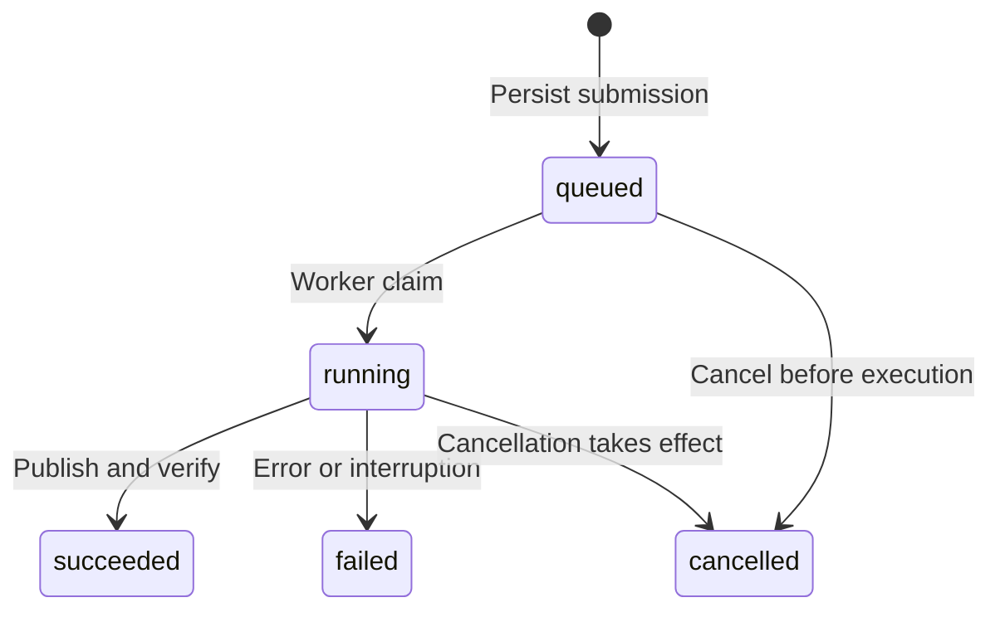

# API reference

All `/v1/*` endpoints require `Authorization: Bearer <token>`. The server maps the token to a
namespace; request bodies cannot choose one. Both storyboard schemas use the `/v1/` HTTP
paths. `schema_version` defaults to 1; set it to 2 for narration, structured mathematics,
additional templates, or subtitles.

Health endpoints, the OpenAPI document, and the interactive `/docs` reference are public.
Calling the documented `/v1/*` operations still requires authentication.

## Submit, inspect, and download

Set `P2V_TOKEN` from your credential store. From the source checkout:

```bash
curl --fail-with-body http://127.0.0.1:8090/v1/templates \
  -H "Authorization: Bearer $P2V_TOKEN"
curl --fail-with-body http://127.0.0.1:8090/v1/jobs \
  -H "Authorization: Bearer $P2V_TOKEN" \
  -H 'Content-Type: application/json' \
  -H 'Idempotency-Key: demo-storyboard-v2' \
  --data-binary @examples/v2-templates.json
```

Use the returned `id` as `JOB_ID`. Poll its state, and download only after `succeeded`:

```bash
curl --fail-with-body "http://127.0.0.1:8090/v1/jobs/$JOB_ID" \
  -H "Authorization: Bearer $P2V_TOKEN"
curl --fail-with-body "http://127.0.0.1:8090/v1/jobs/$JOB_ID/artifact" \
  -H "Authorization: Bearer $P2V_TOKEN" --output result.mp4
```

A new submission returns `202` only after the request is persisted. Rendering is asynchronous.
After a successful download, compare the SHA256 and byte count against the job's `result`.
The curl commands above illustrate the endpoints; the [complete client](#complete-client-example)
also polls, refuses overwrites, and verifies the downloaded bytes.

`GET /v1/templates` returns supported schema versions `[1, 2]`, all 12 template names,
actions, target conventions, an example, and the storyboard JSON Schema. Unknown fields
are rejected. See [templates](templates.md) for content and output limits.

## Idempotency, cancellation, and retry

`Idempotency-Key` is optional and must contain 1-128 characters. Within a namespace, the
same key and normalized storyboard return the existing job with HTTP `200`. The same key
with different content returns `409 idempotency_conflict`. Omitting the key creates a new
job, even when rendering can reuse cached content.

If a POST times out and acceptance is uncertain, repeat it with the same key and content.
Use a new key after changing the input. A key associated with a failed job returns that
failed job; it does not trigger another render.

`POST /v1/jobs/{id}/cancel` immediately cancels a queued job, or sets a cancellation request
for a running one. Poll until a terminal state. Active subprocess groups are terminated as
cancellation takes effect. Cancelling a terminal job leaves its outcome intact and does not
delete artifacts.

`POST /v1/jobs/{id}/retry` accepts only `failed` or `cancelled` jobs. It copies the storyboard
into a new queued job with a new ID and preserves the original record. Retry has no
idempotency contract; do not blindly repeat an uncertain retry request. It may fail again if
the input or environment problem remains. There is no automatic retry or completion webhook.

## Upload audio

```bash
curl --fail-with-body http://127.0.0.1:8090/v1/assets \
  -H "Authorization: Bearer $P2V_TOKEN" \
  -H 'Content-Type: application/octet-stream' --data-binary @narration.wav
```

The body is raw audio bytes, not multipart form data, a local path, or a remote URL. The
response contains `id`, `sha256`, `size_bytes`, and probed `duration`. Default limits are
25 MiB per asset and 256 KiB for other request bodies. Uploaded media must contain exactly
one audio stream and have a probed duration of at most 600 seconds. Supported demuxers cover
common formats such as WAV, MP3, FLAC, OGG, AAC, M4A, and Matroska; FFmpeg must be able to
decode the actual input. Video streams, playlists, and network protocols are not accepted.

Assets belong to the authenticated namespace. Submission checks that referenced records
exist; rendering rechecks the asset bytes against their stored digest. Uploading identical
bytes creates another asset ID, although the content digest can enable cache reuse. Upload
has no idempotency key, listing, download, or deletion endpoint. Save returned IDs yourself.

The segment-level `audio_asset_id` form is available in both schema versions. Audio begins
at the segment start; a shorter input is followed by silence. Audio longer than the requested
segment duration plus 0.1 seconds fails with `audio_longer_than_segment`. Within that
tolerance, audio can be trimmed to the effective video duration. Use V2 narration for a
stricter duration contract and cue-controlled actions.

## V2 timed narration

Upload your audio, then replace `uploaded-audio-id` with its returned ID. This example needs
an audio file at least 3.5 seconds long that fits the four-second segment:

```json
{
  "schema_version": 2,
  "subtitle_mode": "sidecar",
  "output": {"width": 1280, "height": 720, "fps": 24},
  "segments": [{
    "template": "bullets",
    "title": "Explain with evidence",
    "duration": 4,
    "items": ["State the question", "Show the evidence"],
    "narration": {
      "mode": "timed",
      "audio_asset_id": "uploaded-audio-id",
      "cues": [
        {"start": 0, "end": 1.5, "target": "item-1", "text": "Start with a question."},
        {"start": 2, "end": 3.5, "target": "item-2", "text": "Then show the evidence."}
      ]
    }
  }]
}
```

Cue times are seconds relative to the segment start. They must be ordered, nonoverlapping,
and within both the audio and segment. `start` is at least 0 and less than 60; `end` is
greater than `start` and at most 60. Each segment has 1-32 cues, each with 1-140 characters
of trimmed subtitle text. Timing comes from the caller; the service does not perform speech
recognition, forced alignment, or TTS.

The engine first resolves `frames = round(duration * fps)` and uses `frames / fps` as the
effective duration. Python's `round` rule applies, including ties to even. The same resolved
clock drives video actions, audio placement, and subsequent segment offsets. The receipt's
`timeline` reports those values.

To accommodate all audio, choose `ceil(audio_duration * fps) / fps`, within the 1-60 second
segment limits. Timed narration cannot exceed the effective duration, apart from a one-sample
48 kHz tolerance. It is not automatically sped up or trimmed. Cue ends must also fit the
probed audio duration. After nearest-frame quantization, each cue must cover at least one
frame and remain ordered and in bounds. These checks can fail asynchronously after acceptance.

## V2 clip narration

Instead of one timed audio asset, supply individually uploaded clips:

```json
{
  "schema_version": 2,
  "subtitle_mode": "sidecar",
  "segments": [{
    "template": "bullets",
    "title": "Two explanation steps",
    "duration": 8,
    "items": ["Ask a question", "Check the result"],
    "narration": {
      "mode": "clips",
      "utterances": [
        {"audio_asset_id": "first-audio-id", "target": "item-1", "text": "Ask a question.", "gap_after": 0.2},
        {"audio_asset_id": "second-audio-id", "target": "item-2", "text": "Check the result."}
      ]
    }
  }]
}
```

Each of the 1-32 utterances becomes a cue using the probed clip duration. Clips play in input
order. `gap_after` defaults to 0 and may be 0-5 seconds. All clip durations and gaps,
including the final gap, must fit the effective segment duration. Remaining time is silence;
the engine does not extend the segment to fit the clips. The same one-sample tolerance and
frame-quantization checks apply.

A segment cannot combine `narration` with its segment-level `audio_asset_id`. A narration
object selects exactly one mode, `timed` or `clips`.

## Actions and subtitles

Each cue or utterance has an `action` that defaults to `reveal`:

| Action | Behavior |
| --- | --- |
| `reveal` | Show the target at the cue start; it remains until an exit or replacement by another equation/example step |
| `highlight` | Emphasize a visible target during the cue interval |
| `exit` | Remove the target at the cue start |

A target whose first action is `reveal` starts hidden. Targets without cues, or whose first
action is `highlight` or `exit`, start visible. Without narration, templates use their
default reveal sequence. With narration on `equation` or `example`, every `step-N` requires
a `reveal` cue so overlaid steps do not all appear together. Targets are template-specific;
see the [catalog](templates.md).

`subtitle_mode` defaults to `none`. `sidecar` produces SRT without changing the video image.
`burn` renders subtitles into the video and also preserves SRT. Both modes use cue text;
without narration cues, the requested SRT is empty and no text is transcribed from audio.

```bash
curl --fail-with-body "http://127.0.0.1:8090/v1/jobs/$JOB_ID/subtitles" \
  -H "Authorization: Bearer $P2V_TOKEN" --output result.srt
```

A successful job with no requested subtitle attachment returns `404 subtitles_not_available`.
Downloads require the same authentication and integrity checks as the MP4. Damage to either
file prevents successful download verification; one intact file does not bypass the other.

Burned subtitles are limited to two lines in a reserved bottom area. Text that cannot fit
the bounded font size fails with `subtitle_overflow`. Input backslashes and braces are
rendered as full-width literal characters to neutralize ASS commands. SRT escapes HTML
special characters. The font is configured by the server, and `doctor` reports whether
FFmpeg has the required ASS filter. SRT timestamps are rounded to milliseconds; burned
subtitle timestamps use ASS centiseconds, so subtitle display has format-specific precision.

## Endpoints and HTTP responses

| Endpoint | Success | Response |
| --- | --- | --- |
| `GET /health/live` | 200 | `{"ok":true}`; HTTP process responds |
| `GET /health/ready` | 200 or 503 | `{"ready":true/false}`; checks worker health and minimum free disk space |
| `GET /v1/templates` | 200 | Versions, templates, actions, target conventions, example, and JSON Schema |
| `POST /v1/assets` | 201 | Audio asset receipt |
| `POST /v1/jobs` | 202 or 200 | Newly created or idempotently returned job |
| `GET /v1/jobs` | 200 | `{"jobs":[...]}`; latest 50 jobs in the namespace |
| `GET /v1/jobs/{id}` | 200 | Job object |
| `POST /v1/jobs/{id}/cancel` | 200 | Current job object; running cancellation may still be in progress |
| `POST /v1/jobs/{id}/retry` | 202 | New job object |
| `GET /v1/jobs/{id}/artifact` | 200 | MP4; `Cache-Control: private, no-store` |
| `GET /v1/jobs/{id}/subtitles` | 200 | SRT; `Cache-Control: private, no-store` |

Application error bodies use `{"error":"static_code"}` without rejected input or raw
subprocess output. Authentication failures use 401. Valid identifiers outside the namespace
use 404; malformed identifiers can use 422. Conflicts, nonretryable states, unavailable
artifacts, and corrupt artifacts use 409. Oversized bodies use 413; other input validation
uses 422. A full queue uses 429, insufficient disk space uses 507, and an unexpected internal
HTTP exception uses 500.

Asynchronous render failures differ from HTTP failures. An accepted job can later become
`failed`; its GET request still returns 200. Always inspect `state` and `error_code`.

| Error code | Meaning |
| --- | --- |
| `unauthorized`, `job_not_found`, `audio_asset_not_found` | Credentials, namespace, or identifier do not match |
| `invalid_request`, `request_too_large` | Schema or body-byte limit was exceeded |
| `idempotency_conflict`, `job_not_retryable` | Submission key conflicts, or retry is invalid for the state |
| `artifact_not_ready`, `artifact_verification_failed` | Job has no successful output, or persisted output failed verification |
| `queue_full`, `insufficient_disk_space` | Capacity is unavailable |
| `text_overflow`, `math_overflow`, `subtitle_overflow` | Content does not fit the bounded layout |
| `audio_asset_corrupt`, `audio_longer_than_segment`, `cue_outside_audio` | Uploaded audio failed verification or timing does not fit |
| `cue_shorter_than_frame_or_out_of_bounds` | Quantized cue has no frame or falls outside the resolved clock |
| `subtitle_renderer_unavailable` | FFmpeg lacks ASS subtitle support |
| `deadline_exceeded`, `interrupted`, `internal_render_error` | Execution budget, shutdown/restart, or unexpected rendering failure |

This table is a guide rather than an exhaustive error-code list. A failure response from
startup or a render process is not necessarily an HTTP endpoint response.

## Job object and lifecycle

| Field | Meaning |
| --- | --- |
| `id` | Job identity; retry creates another ID |
| `state` | `queued`, `running`, `succeeded`, `failed`, or `cancelled` |
| `created`, `updated` | Unix timestamps in seconds, possibly fractional |
| `completed_segments` | Number of prepared visual segments, including cache reuse; not a completion percentage |
| `cancel_requested` | Cancellation was requested; a running job may not be terminal yet |
| `error_code` | Static failure code; some cancellation paths have `null`, so use `state` as the terminal indicator |
| `result` | Durable artifact receipt on success; otherwise normally `null` |
| `metrics` | Render measurements on success; failed jobs may have an empty object |



Queued jobs survive restart. A running job left by an interrupted process becomes a
terminal failure, or cancelled if cancellation had been requested. Explicit retry creates a
new queued job and does not rewrite the old outcome. There are no SSE or WebSocket events.
Even with every segment prepared, audio assembly and publication can still be running;
wait for `succeeded` before downloading.

`result` includes `sha256`, `size_bytes`, `duration`, `width`, `height`, `fps`, `video_codec`,
`audio_codec`, `storage=filesystem`, `namespace`, `job_id`, `runtime_fingerprint`, and
`timeline`. Each timeline entry contains `frames`, effective `duration`, and explicit
`events`. Event `frame` and `end_frame` are segment-local; sum earlier effective durations
to locate a segment in the whole video. Container duration has encoding tolerance; use the
resolved timeline for animation coordinates.

Requested subtitles add `attachments.subtitles` with `filename`, `size_bytes`, and
`sha256`. Receipts contain neither a public artifact URL nor an absolute storage path.
Retrieve files through authenticated endpoints.

Metrics include cache/render counts, video reencodes, audio encodes/decodes, and queue,
render, layout, normalization, audio, concatenation, mux, subtitle, and publication times.
`cache_hits` counts reused segments; on a composition hit it equals the segment count.
Do not add it to `visual_cache_hits`. `layout_seconds` is part of `render_seconds`, and
`subtitle_seconds` is part of `mux_seconds`. `total_seconds` excludes queue waiting and
includes additional probing, hashing, locks, and I/O; adding every field is not meaningful.
CPU time and process-tree RSS are sampled, not exact billing or exclusive-memory values.

## Complete client example

This Python standard-library example submits the silent example, polls to a terminal state,
downloads without following redirects, and checks the byte count and SHA256 before publishing
the local file. Start the API first and provide `P2V_TOKEN` in the client environment.
Optionally set `P2V_BASE_URL` and `P2V_IDEMPOTENCY_KEY`. Save the script and run it from the
source checkout. Reuse the key only for the same intended input.

```python
import hashlib
import json
import os
import time
import urllib.error
import urllib.request
from pathlib import Path

base = os.environ.get("P2V_BASE_URL", "http://127.0.0.1:8090").rstrip("/")
token = os.environ["P2V_TOKEN"]
key = os.environ.get("P2V_IDEMPOTENCY_KEY", "minimal-demo-v1")
headers = {"Authorization": "Bearer " + token}


class NoRedirect(urllib.request.HTTPRedirectHandler):
    def redirect_request(self, request, response, code, message, response_headers, new_url):
        return None


opener = urllib.request.build_opener(NoRedirect())


def call(path, payload=None, extra=None):
    body = json.dumps(payload).encode("utf-8") if payload is not None else None
    request_headers = dict(headers)
    if body is not None:
        request_headers["Content-Type"] = "application/json"
    request_headers.update(extra or {})
    request = urllib.request.Request(base + path, data=body, headers=request_headers)
    try:
        with opener.open(request, timeout=30) as response:
            return json.load(response)
    except urllib.error.HTTPError as exc:
        raise SystemExit(f"HTTP {exc.code}; inspect the static error code locally") from None
    except urllib.error.URLError:
        raise SystemExit("connection_failed") from None


spec = json.loads(Path("examples/minimal.json").read_text(encoding="utf-8"))
job = call("/v1/jobs", spec, {"Idempotency-Key": key})
job_id = job["id"]
print("job_id:", job_id)
# The client budget includes queue waiting. Expiry does not cancel the server-side job.
deadline = time.monotonic() + 2400
while job["state"] in {"queued", "running"}:
    if time.monotonic() >= deadline:
        raise SystemExit("client_wait_timeout; query the same job_id later")
    time.sleep(1)
    job = call(f"/v1/jobs/{job_id}")
if job["state"] != "succeeded":
    raise SystemExit(f"{job['state']}: {job.get('error_code')}")

output = Path(".artifacts") / (job_id + ".mp4")
output.parent.mkdir(parents=True, exist_ok=True)
if output.exists():
    raise SystemExit("output_already_exists")
partial = output.with_suffix(".mp4.part")
request = urllib.request.Request(base + f"/v1/jobs/{job_id}/artifact", headers=headers)
digest, size = hashlib.sha256(), 0
with partial.open("xb") as target:
    with opener.open(request, timeout=60) as response:
        while chunk := response.read(1024 * 1024):
            target.write(chunk)
            digest.update(chunk)
            size += len(chunk)
receipt = job["result"]
if digest.hexdigest() != receipt["sha256"] or size != receipt["size_bytes"]:
    raise SystemExit("download_verification_failed; keep .part for investigation")
# Exclusive creation of the final name avoids overwriting another file.
os.link(partial, output)
partial.unlink()
print("verified:", output, size)
```

The final link step uses a Linux/WSL local filesystem. Download failures leave `.part`, which
is not accepted output. Remove it only after confirming ownership, or choose another output
name before retrying. Use TLS for remote access and protect the token; the example rejects
redirects so it does not forward Authorization to another location. A production client
also needs bounded network retries, rate-limit backoff, and token rotation.

Retry uncertain initial submissions with the same key and content. Do not blindly replay
uploads or explicit retry operations. Fix 422 input errors before resubmitting, wait for
capacity after 429, and resolve storage pressure after 507. Query and download failures can
use bounded retries without creating new jobs.

## Namespace integration

Several tokens may map to one namespace for rotation or shared access. Every such token can
access all jobs and assets in that namespace; token sharing is not user-level authorization.
Mappings load at process startup and require a restart to change. Identifiers and request
fields cannot switch a client into another namespace.

The job list contains the latest 50 records with no pagination or search. There are no user
management, job deletion, or public artifact-sharing endpoints. Maintain your own durable
mapping of input versions, asset IDs, job IDs, and idempotency keys instead of using the
recent-job list as a long-term application index. Caches remain isolated by namespace.
