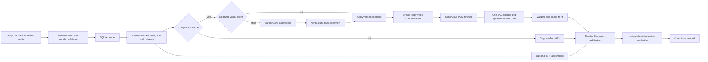

# Architecture

Study P2V 0.2.0 is a single-host service that turns bounded storyboard data and uploaded audio into verified MP4 artifacts. The HTTP API and local CLI share the same queue, renderer, and filesystem storage. See the [API](api.md), [CLI](cli.md), and [template reference](templates.md) for input contracts.



## Input and trust boundaries

[models.py](../src/study_p2v/models.py) rejects unknown fields and nonfinite numbers. A storyboard contains one to twenty-four segments, each one to sixty seconds, with a total requested duration of at most six hundred seconds. Output is landscape 16:9 within the supported dimensions, at 15, 24, or 30 fps. Schema versions 1 and 2 are accepted; narration, structured mathematics, additional templates, and subtitle modes require version 2.

The service accepts structured data rather than executable scenes. Callers cannot supply Python, shell commands, TeX programs, remote media URLs, storage roots, or a namespace in job JSON. HTTP namespaces come from the configured token mapping. The local CLI accepts a namespace from its trusted operator. Job and asset IDs are locators, not access credentials.

This input boundary reduces the attack surface but does not turn native media decoders into a complete sandbox. The deployment must supply appropriate filesystem permissions, resource limits, network policy, and authenticated access. See [deployment](deployment.md).

## One timeline

[timing.py](../src/study_p2v/timing.py) first resolves a segment to `round(duration * fps)` frames. Its effective duration is that frame count divided by fps. The resolved timeline drives visual actions, audio placement, and subtitle offsets.

Timed narration attaches cues to one uploaded audio asset. Clip narration places utterances consecutively using probed audio durations and explicit gaps. Cue targets must exist, intervals must be ordered, and each quantized interval must span at least one frame. Version 2 narration fails when its audio or final gap exceeds the effective segment duration; it does not accelerate narration to make it fit. The segment-level `audio_asset_id` contract has a 0.1-second tolerance and can trim within that tolerance.

[scene.py](../src/study_p2v/scene.py) uses one `FrameTimeline` animation per segment. Reveal, highlight, and exit actions operate on registered target IDs. Equation and worked-example steps share an exclusive display region, so revealing one step hides the others. Templates without explicit cues use a default reveal schedule on the same frame clock.

## Text and mathematics

Manim uses its Cairo renderer in a separate process. Pango measures text in the configured font; wrapping and scaling use actual object dimensions. Text that would become too small or leave the safe area fails explicitly instead of being silently clipped. Higher output resolution does not enlarge the logical layout area.

[math_render.py](../src/study_p2v/math_render.py) renders a bounded expression tree containing symbols, rows, fractions, roots, subscripts, superscripts, and matrices. Tree depth is limited to eight, total nodes to one hundred twenty-eight, and matrices to four rows and four columns. Symbol text passes an allowlist. MathText generates symbol SVG paths, while Manim arranges the mathematical structure. External TeX is unnecessary. Nested mathematics must still satisfy the renderer's minimum readable glyph size.

## Media preparation

[media.py](../src/study_p2v/media.py) verifies each silent visual segment's codec, dimensions, frame rate, frame count, and pixel format. A conforming segment is copied; scaling or frame correction uses a normalization encode. Before stream-copy concatenation, the renderer compares H.264 stream signatures, including profile, level, time base, and codec extradata. Incompatible streams fail rather than being joined without validation.

Audio is decoded to 48 kHz stereo, 16-bit PCM. Each distinct audio digest is decoded once per composition. The entire video's audio is placed using absolute sample boundaries:

```text
start_sample = round(start_seconds * 48000)
part_samples = round(end_seconds * 48000) - start_sample
```

Adjacent intervals share endpoints, avoiding cumulative rounding errors from independent clip lengths. Unused timeline space receives silence. A final FFmpeg mux encodes AAC once, including videos with no supplied audio. Without burned subtitles, the final video stream is copied. Subtitle burning uses ASS in the same mux operation and adds a video encode. Both subtitle modes also publish SRT; an empty cue list produces an empty sidecar.

Final output has one H.264/yuv420p video stream and one AAC/48 kHz/stereo audio stream. Validation checks exact video frames, requested dimensions and fps, bounded audio/container duration differences, file size, and SHA256. Metadata validation is not a full frame-by-frame decode or visual review.

## Two content caches

Caches live inside each namespace and use a per-key `flock`. Entries are published through an atomic directory rename. A hit requires matching key, size, SHA256, and media specifications. Corrupt entries are rebuilt. Cached bytes are copied into job scratch while the lock is held.

| Layer | Identity inputs | Reuse behavior |
| --- | --- | --- |
| Visual segment | Template content, effective frames, quantized visual actions, theme, output profile, font content digest, visual source and dependency fingerprint | Audio bytes and subtitle words are excluded when visual actions stay unchanged |
| Complete composition | Ordered visual keys, audio content digests and placements, burned subtitle entries, media source fingerprint, FFmpeg fingerprint, encoding settings | A hit avoids Manim and encoding, while still verifying inputs, cache bytes, and publication |

Changing one segment can reuse the others. Replacing narration with unchanged visual actions can reuse every visual segment. Changing only SRT text can reuse the complete MP4 when subtitles are not burned; the sidecar is regenerated for the new job.

Manim's own media caching is disabled. [runtime.py](../src/study_p2v/runtime.py) fingerprints relevant source files, Python and package versions, font bytes, FFmpeg version output, and the cache epoch. Restart after code or environment changes so the fingerprint is recalculated. Add any new rendering module to the fingerprint list. Native libraries not represented by the fingerprint require an explicit `P2V_CACHE_EPOCH` change. Cache invalidation does not delete existing artifacts or old cache entries.

## Queue, cancellation, and success

[store.py](../src/study_p2v/store.py) uses short SQLite WAL transactions. Acceptance is committed before the API acknowledges it. Idempotency keys are namespace-scoped; a conflicting request returns a conflict. Claiming a job checks namespace concurrency before taking it, preserving worker capacity for other namespaces.

Only one [Engine](../src/study_p2v/engine.py) may own a data directory. On startup, queued work remains eligible, while abandoned running jobs become `failed/interrupted` or `cancelled`. Retry creates a new ID and retains the original outcome. Worker threads share the process; increasing them does not create additional HTTP server processes.

[process.py](../src/study_p2v/process.py) launches argument lists without a shell, applies deadlines and cancellation checks, and terminates process groups with TERM followed by KILL on failure. Child environments omit API tokens and unrelated host secrets. PCM assembly also checks its budget and cancellation between writes.

Success requires validated output, durable filesystem staging, fsync, atomic publication, and independent reads of the destination MP4, manifest, and optional SRT. The Engine verifies again before committing `succeeded`. Downloads repeat file integrity verification. They do not re-run media probes.

Cancellation and finalization compete in a transaction. If cancellation is committed first, success cannot replace it. A published file may remain after cancellation wins; that orphan is not downloadable and does not change the terminal state. Normal completion removes job scratch, while a crash can leave temporary directories for an operator to inspect.

## Scope and extension boundaries

SQLite state and artifact manifests provide separate evidence of completion. A file, subprocess exit, or temporary playback URL alone cannot satisfy the success contract.

The implemented storage target is a local filesystem. There are no distributed worker leases, automatic retention cleanup, TTS providers, external image/video imports, object storage, or editing UI. Do not scale by sharing SQLite over NFS or increasing Uvicorn processes. A storage adapter must preserve durable verification; distributed scheduling requires explicit ownership and lease semantics. See [development](development.md), [operations](operations.md), and [performance](performance.md).
